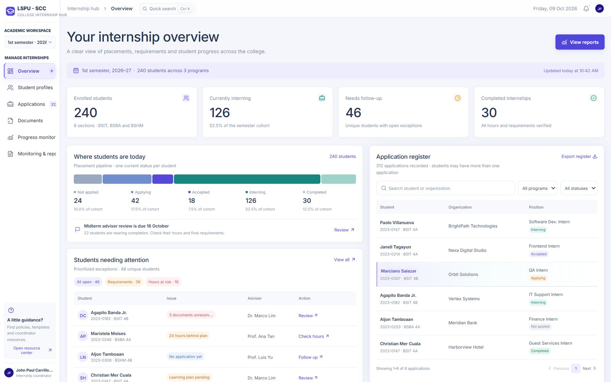
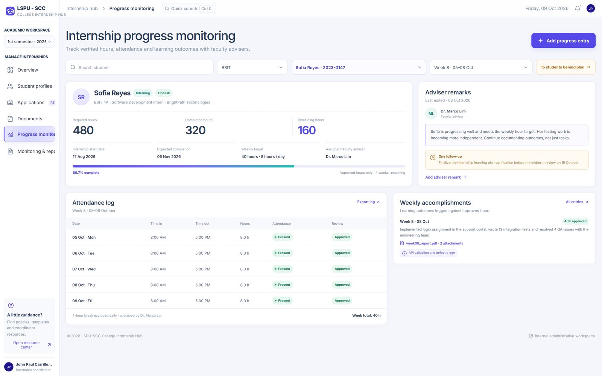
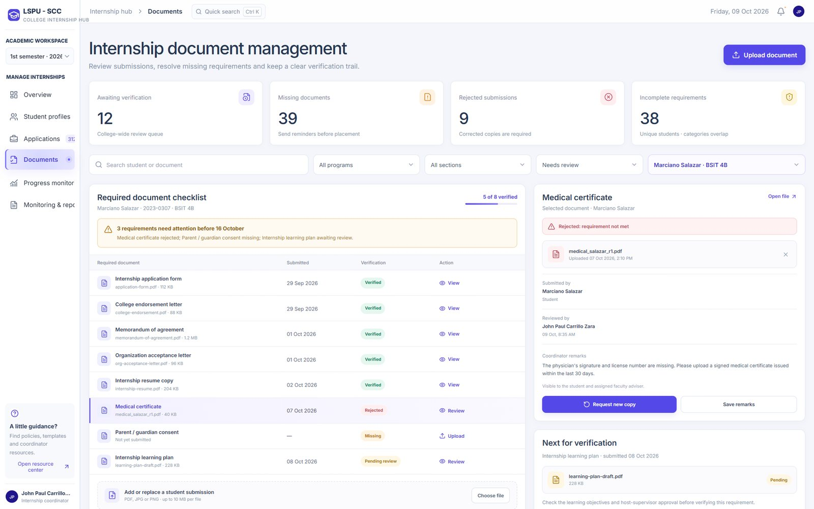

# College Internship Monitoring and Management System

## Overview

The College Internship Monitoring and Management System (College Internship Hub) is a web-based prototype intended for the internship coordinators of LSPU-SCC. It consolidates the records involved in supervising student internships, namely placements, applications, required documents, and rendered hours, into a single workspace.

The system includes a React frontend and an Express backend that stores its data in MySQL. SQLite remains available as an option for running without a database server.



## Objectives

1. To give coordinators a single view of each student's placement status, from application to completion.
2. To track the submission and verification of required internship documents.
3. To monitor rendered hours, attendance, and weekly accomplishments throughout the internship period.

## Features

1. Overview dashboard. A placement pipeline (not applied, applying, accepted, interning, completed) in which each stage filters the application register, together with a list of students who require follow-up.
2. Student profiles and application register. Records can be searched, filtered, and paginated, and the filtered rows can be exported as a CSV file.
3. Document verification. Each student has a checklist of requirements, with space for the coordinator's remarks.
4. Progress monitoring. Rendered and remaining hours, attendance (days present and last attendance), weekly accomplishments drawn from the daily work summaries, and faculty adviser remarks are recorded per student. Students see their adviser's remarks in their hour log.
5. Monitoring and reports. Students are sorted into monitoring lists: not applied, currently applying, accepted, currently interning, incomplete requirements, insufficient hours (approved hours behind the pace expected from the start and expected completion dates, or the completion date has passed), nearing completion (at least 80% of required hours), and completed. A report by program and section counts the students on each list, and every list and report can be exported as CSV.
6. Keyboard support. Ctrl + K opens the quick search, and Esc closes any open dialog.

| Progress monitoring | Document verification |
|---|---|
|  |  |

## Technologies Used

- React
- TypeScript
- Vite
- lucide-react (icons)
- Express and Sequelize
- MySQL

## Installation and Usage

Node.js 22 or later and MySQL Server 8.0 or later are required.

Install dependencies in both applications:

```powershell
cd backend
npm install
Copy-Item .env.example .env
```

Edit `backend/.env`: set `DB_USER` and `DB_PASSWORD` to your MySQL account, and set `ADMIN_PASSWORD` to a password with at least 10 characters. Then create the database and tables, and the administrator account:

```powershell
npm run db:migrate
npm run db:seed
```

### Moving existing SQLite data to MySQL

If you previously ran the system on SQLite (`DB_DIALECT=sqlite`), copy its records into MySQL instead of seeding. Set `DB_DIALECT=mysql` in `backend/.env`, then:

```powershell
npm run db:migrate
npm run db:copy-from-sqlite
```

The copy only runs into an empty MySQL database and is all-or-nothing. The SQLite file is left untouched, and uploaded files in `backend/uploads` are reused as they are. To check the API against MySQL, run `npm run test:integration:mysql`, which uses a temporary database and removes it afterwards.

Start the backend in one terminal:

```powershell
cd backend
npm run dev
```

Start the frontend in a second terminal:

```powershell
cd frontend
npm install
npm run dev
```

Open http://localhost:5173. Select Admin and sign in with the email and password configured in `backend/.env`. The frontend proxies `/api` requests to the backend at http://127.0.0.1:3001.

To type-check and produce a production build in `frontend/dist`:

```bash
npm run build
```

## Repository Structure

```
frontend/   React and TypeScript client (pages, layout, components, styles)
backend/    Express API, SQLite/MySQL persistence, migrations, and seed scripts
docs/       Screenshots used in this document
```

## Author

Karl Sebastian V. Cuerdo
